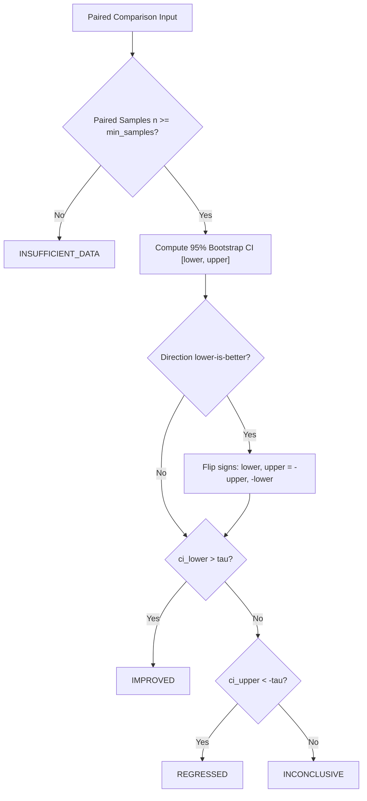

# Statistical Regression Decision Engine

The Regression Decision Engine in `LLM Evaluation Lab` provides automated, objective go/no-go verdicts for model releases and prompt migrations.

---

## 1. Decision States

Every metric comparison produces one of four mutually exclusive decisions evaluated against confidence interval bounds and an absolute practical threshold $\tau \ge 0$ (default $\tau = 0.0$ in `RegressionConfig`):

| Decision | State Meaning | Deployment Recommendation |
|---|---|---|
| `IMPROVED` | CI lower bound exceeds threshold ($\text{CI}_{\text{lower}} > \tau$). For $\tau=0.0$, entire 95% CI is strictly positive. | **Approve / Deploy** |
| `REGRESSED` | CI upper bound falls below negative threshold ($\text{CI}_{\text{upper}} < -\tau$). For $\tau=0.0$, entire 95% CI is strictly negative. | **Block / Reject** |
| `INCONCLUSIVE` | The 95% CI spans zero, or fails to clear the practical significance threshold $\tau$. | **Hold / Investigate** |
| `INSUFFICIENT_DATA` | Fewer than `min_samples` (default 5) paired samples available between baseline and candidate. | **Insufficient Evidence** |

---

## 2. Decision Logic Flowchart



---

## 3. Overall Experiment Verdict

An evaluation experiment often measures multiple metrics simultaneously (e.g., `exact_match`, `token_overlap_f1`, and `latency_ms`).

### Quality vs. Informational Metrics
To ensure clean, un-muddled releases:
- **Quality Metrics** (`exact_match`, `token_overlap_f1`, `keyword_coverage`, `json_validity`, `json_schema_compliance`, `semantic_similarity`, `judge_score`): These metrics evaluate correctness and adherence to expectations. They directly govern the **Overall Decision**.
- **Informational / Operational Metrics** (`latency_ms`): Wall-clock latency is tracked, analyzed with bootstrap CIs, and displayed in the report, but is excluded from the overall quality decision by default so that latency jitter does not silently veto a quality comparison. Dedicated operational thresholds can be configured when latency gating is required.

The composite overall quality verdict is calculated using conservative safety rules across quality metrics:
1. **Regression Priority:** If **any** evaluated quality metric is classified as `REGRESSED`, the entire experiment is declared `REGRESSED`.
2. **Improvement Condition:** If **all** evaluated quality metrics are `IMPROVED`, the experiment is declared `IMPROVED`.
3. **Insufficient Data:** If all quality metrics have insufficient data, the verdict is `INSUFFICIENT_DATA`.
4. **Otherwise:** The experiment is declared `INCONCLUSIVE`.

---

## 4. CI/CD Pipeline Integration

You can gate CI/CD workflows on regression decisions using the `llm-eval compare` CLI:

```bash
# Compare candidate run against baseline in CI pipeline
llm-eval compare \
  --baseline exp-production-baseline \
  --candidate exp-pr-branch \
  --output-dir ./reports

# Exit with code 1 if regression is detected
```

In GitHub Actions:
```yaml
- name: Run Model Regression Check
  run: |
    llm-eval compare --baseline $PROD_RUN_ID --candidate $PR_RUN_ID
```
